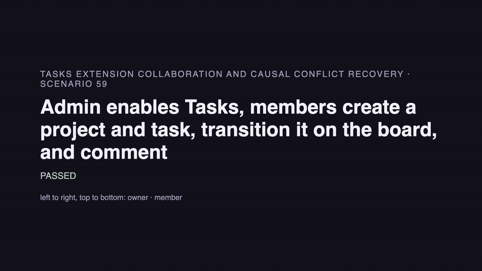

# atproto Slack clone

A Slack-style team workspace built directly on atproto permissioned data ("spaces"), with direct messages that the app server cannot read, gate or lose.

There is no app database of record. Each workspace, channel, extension space and conversation lives in spaces on the members' own PDSes, and the member lists on those PDSes decide who can read and write. The browser talks directly to PDS hosts with key-bound space credentials and RFC 9421 message authentication codes; a small separate-origin operator service handles journaled, resumable membership mutations and content-free change cursors.

**Links:** [**Interactive Presentation Slides**](https://atproto-sandbox.github.io/atprotocol-slack-clone/presentation/r12-atproto-conference-deck.html) · [**Full E2E Demo Video (MP4)**](https://atproto-sandbox.github.io/atprotocol-slack-clone/media/bdd-session.mp4) · [**Developer Onboarding**](docs/dev-onboarding.md) · [**Architecture**](ARCHITECTURE.md)

> **Status: alpha.** Targets proposal 0016 and the draft PDS implementation (PR [#5187](https://github.com/bluesky-social/atproto/pull/5187), commit `6747610566`, npm snapshot `0.0.0-spaces-alpha-20261117141222`), which is not a released protocol. Expect breaking changes when upstream moves. Nothing here has been deployed or load-tested beyond local fixtures.

## End-to-end demo

[](https://atproto-sandbox.github.io/atprotocol-slack-clone/media/bdd-session.mp4)

Full 27.3-minute recording of all 74 default Chromium/Playwright Gherkin scenarios running against real in-memory PDSes: [**stream on GitHub Pages**](https://atproto-sandbox.github.io/atprotocol-slack-clone/media/bdd-session.mp4) or view [`docs/media/bdd-session.mp4`](docs/media/bdd-session.mp4) (Git LFS).

## What it does

- **Workspaces and channels:** public and private channels, rich message blocks and interactive actions, one-level replies, one reaction per author, message and emoji, message permalinks, private-channel join requests with admin approval, dedicated workspace authority accounts, admin promote and demote, leave and remove, archive.
- **Invitations:** an admin adds a member by DID and copies an invite link. The member opens it, signs in and sees a banner offering to join. The PDS member list is the only gate; the link grants nothing by itself.
- **Direct messages:** one-to-one and groups of up to 100. Each participant owns only their own half of a conversation and their own inbox, with a write policy they set (everyone, only people I allow, nobody). Live updates use `authorizeSpaceSync` with stateless per-caller `dm1` webhook tokens gated by RFC 9421 space-credential proof-of-possession; the operator stores **zero DM rows** in SQLite and relays only ephemeral in-memory change cursors.
- **Apps, slash commands and webhooks:** workspace-installed apps (`apps/echo-bot`, `apps/webhooks`) run under narrow app OAuth grants with per-app inboxes, `/command` dispatch, interactive block callbacks and HMAC-authenticated incoming webhooks.
- **Collaborative Tasks extension:** first-party workspace extension (`new.flock.ext.tasks`) with projects, Kanban board, list and activity views, comments, verified STAR archive + oplog sync (`@atproto/star`), and a pure causal-DAG + HLC + OR-Set merge engine that surfaces and recovers concurrent edits without data loss.
- **Independent readers:** `packages/reader/src` ships three standalone readers—workspaces/channels (`independent.ts`), DMs (`independent-dm.ts`) and Tasks (`independent-tasks.ts`)—built strictly on `@flock/protocol` and `@atproto/{space,star}` without this app's database or client engine, proving zero lock-in.
- **Operator:** separate-origin XRPC service (`apps/operator`) with journaled, idempotent membership mutations, inline `authorizeSpaceSync` webhook registration with 60-second continuous renewal and `spaceRev` gap catch-up, `listWriters` (`#repoWrite` / `#repoRemoved`) reconciliation, quarantined authority OAuth handling across temporary host suspension, a pause switch and stalled-operation alerts.

## How it is built

A pnpm TypeScript monorepo: Next.js 16 (App Router) in `apps/web` (stateless browser shell holding non-extractable OAuth keys in IndexedDB), `@flock/client` (isomorphic sync engine + `DmClient`), `@flock/protocol` (lexicons under `packages/protocol/lexicons/new/flock/`, record validation, entity merge, RFC 9421 MAC & STAR verification), `@flock/reader`, and `apps/operator` (Node + SQLite for authority grants, mutation journal and non-DM space notices).

New to **atproto Spaces**? Start with [`docs/dev-onboarding.md`](docs/dev-onboarding.md) (diagrams and FAQ). See [`ARCHITECTURE.md`](ARCHITECTURE.md) for runtime boundaries and data flow, [`CODE-MAP.md`](CODE-MAP.md) for the directory map and canonical module owners, and [`SPEC.md`](SPEC.md) for product scope.

## Run it locally

You need Node 22.17 (`.nvmrc`) and pnpm 11 (`corepack pnpm`). The local stack runs two in-memory PDS hosts, a PLC directory, the operator and the web app from a pinned atproto checkout.

1. Check out and build the pinned atproto revision (`6747610566`) next to this repo as `atproto-spaces-r12`, and apply `protocol-tests/atproto/strict-credential-expiry.patch`. Full instructions are in [`docs/protocol/atproto-spaces-pin.md`](docs/protocol/atproto-spaces-pin.md).
2. Install and build:

   ```sh
   corepack pnpm install --frozen-lockfile
   corepack pnpm build
   ```

3. Start the playground:

   ```sh
   ATPROTO_PINNED_CHECKOUT=../atproto-spaces-r12 corepack pnpm playground
   ```

   It prints a local URL and four ready-made accounts, all with the password `playground-pass`. Type the account's DID (not the handle) into the sign-in box. Everything lives in memory and disappears when you stop it.

For a real deployment, run the web app and the operator (`corepack pnpm operator`) as two processes on their own origins. Copy `.env.example` to `.env` at the repository root (or set the same variables in each process's environment): both need `APP_URL`, `OPERATOR_URL`, `PLC_URL` and `OPERATOR_SERVICE_REF`; the operator also needs `DATABASE_PATH`, `AUTH_ENCRYPTION_KEY` and `AUTHORITY_CLIENT_PRIVATE_JWKS`. The operator DID's `did:web` document is served by the operator at `OPERATOR_URL`, and public deployments require HTTPS (upstream PDS `safeClient` SSRF checks reject private IP webhook targets outside loopback development). See [`docs/operations.md`](docs/operations.md).

## Tests

| Command | What it runs |
|---|---|
| `pnpm codegen:lex` | verifies pinned checkout (`ATPROTO_PIN_CHECKOUT`) and regenerates Lexicon types |
| `pnpm typecheck`, `pnpm lint` | TypeScript (including Node-free browser boundary checks) and ESLint |
| `pnpm test` | 939 unit/component tests and the Gherkin ratchet gate (`bdd/gate.test.ts`) |
| `pnpm test:bdd` | 74 Gherkin scenarios through real Chromium against the local PDS stack |
| `pnpm test:bdd:chrome` | the same in visible Google Chrome |
| `pnpm test:bdd:video` | the same in Chrome, stitched into `test-results/videos/bdd-session.mp4` |
| `pnpm test:bdd:slow` | the 2 `@slow` scenarios delegating to long protocol/envelope tests (~30 min) |
| `pnpm test:acceptance`, `pnpm test:browser` | 13 backend acceptance suites and 8 Playwright browser specs |
| `pnpm test:sync-budget`, `pnpm test:sync-budget:browser` | warm-reopen request budgets across 20 / 100 / 200 writers |
| `pnpm test:performance` | 200-member, 2,000,000-record workspace envelope, 100-participant DM budget, and Tasks RSS envelope |

The behavior contract is [`features/*.feature`](features). 76 of 77 scenarios are executable (74 in the default run plus 2 `@slow` scenarios); the single `@unbound` scenario—that the final admin cannot leave—has no UI path and is covered by `protocol-tests/app-acceptance.test.ts`. The gate fails if that count grows or if any bound scenario lacks a step definition. A full recording of the 74-scenario run is in [`docs/media/bdd-session.mp4`](docs/media/bdd-session.mp4) (Git LFS).

Set `ATPROTO_PINNED_CHECKOUT=../atproto-spaces-r12` (and `ATPROTO_PIN_CHECKOUT=../atproto-spaces-r12` for `codegen:lex`) when running the suites.

## Conference deck

GitHub’s README cannot run interactive HTML (no slide keyboard navigation in the markdown view). Use **GitHub Pages** for the full deck, or open the HTML file locally.

[](https://atproto-sandbox.github.io/atprotocol-slack-clone/presentation/r12-atproto-conference-deck.html)

| Format | Link |
|---|---|
| **Interactive slides** (arrow keys, fullscreen) | [GitHub Pages](https://atproto-sandbox.github.io/atprotocol-slack-clone/presentation/r12-atproto-conference-deck.html) |
| **Source in repo** | [`docs/presentation/r12-atproto-conference-deck.html`](docs/presentation/r12-atproto-conference-deck.html) |
| **UI demo video** (slide 1) | [GitHub Pages MP4](https://atproto-sandbox.github.io/atprotocol-slack-clone/media/bdd-session.mp4) · [`docs/media/bdd-session.mp4`](docs/media/bdd-session.mp4) |

## Project notes

- [`protocol-authors-feedback.md`](protocol-authors-feedback.md): synthesis for the atproto Spaces protocol authors—what we built, what worked well, and prioritized protocol recommendations.
- [`PROGRESS.md`](PROGRESS.md) and [`.ai/plans/r12-protocol-drift-progress.md`](.ai/plans/r12-protocol-drift-progress.md): implementation waves, R12 protocol alignment and verification gate logs.
- [`.ai/upstream/`](.ai/upstream): draft protocol feedback notes for the atproto core team.
- [`.ai/reviews/`](.ai/reviews): adversarial architecture, security and protocol conformance reviews.
- [`docs/prd/`](docs/prd) and [`docs/protocol/`](docs/protocol): product requirements, operator contract and upstream pin documentation.

## Known limits

- The pinned PDS allows five seconds of credential expiry skew across token types. This repo carries `protocol-tests/atproto/strict-credential-expiry.patch` so space credentials expire strictly at `exp`; deployments must run with this patch or an equivalent upstream revision.
- DM wakes live exclusively in operator memory (coordinated across local workers over a `0600` IPC socket with zero SQLite DM rows); an operator restart resets the ephemeral DM cursor and prompts connected clients to resync once from their PDSes.
- While the operator quarantines authority OAuth state across temporary `AccountDeactivated` / `AccountTakedown` responses, upstream PDS currently revokes OAuth refresh tokens on account takedown, requiring authority re-approval after restoration if the access token expired during takedown (documented in [`docs/protocol/operator-contract.md`](docs/protocol/operator-contract.md)).
- Permissioned spaces have no cross-PDS query for spaces an account was added to, so workspace invitations rely on out-of-band invite links until upstream adds discovery.
