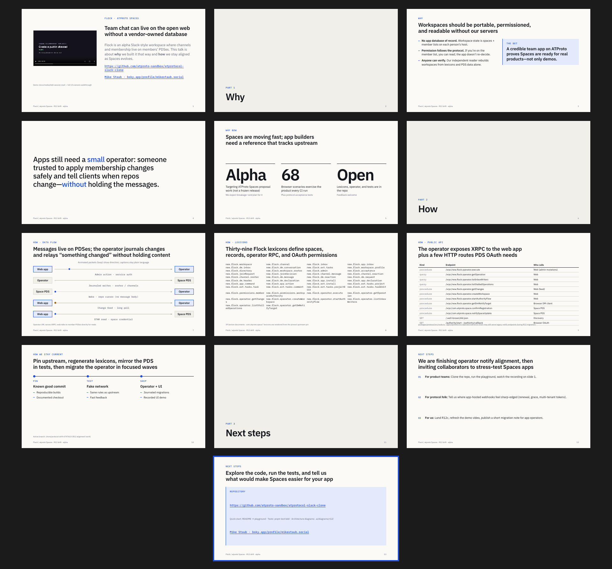

# atproto Slack clone (Flock)

A Slack-style collaborative workspace built on **`opensocial.group` atmospheric groups (`1 Group == 1 DID`)** over atproto permissioned data ("spaces"), alongside person-scoped Direct Messages (`new.flock.dm.*`) hosted directly on each participant's personal PDS so no app server can read, gate, or lose a DM.

There is no proprietary application database of record for content or membership. Every group is its own `did:plc:...` account hosted on an **`opensocial.group` Group Host** (`apps/group-host`), publishing core governance spaces (`group.opensocial.meta/self`, `group.opensocial.members/self`) and Flock modality spaces (`new.flock.workspace/self`, `new.flock.inbox/self`, `new.flock.channel/<skey>`, `new.flock.app.inbox/<appSkey>`, `new.flock.ext.tasks/<tasksSkey>`) governed by flat union RBAC (`group.opensocial.policy`). Member-authored messages, reactions, Tasks operations, and bilateral `group.opensocial.acceptance/self` records live in each member's personal PDS repo; the browser reads and verifies spaces directly with key-bound `Atproto-Space-Credential` tokens and ephemeral HPKE KEM-MACs, while a separate-origin Operator (`apps/operator`) orchestrates multi-space modality mutations and content-free change cursors.

**Links:** [**Interactive Presentation Slides (R12 Baseline)**](https://atproto-sandbox.github.io/atprotocol-slack-clone/presentation/r12-atproto-conference-deck.html) · [**Full E2E Demo Video (MP4)**](https://atproto-sandbox.github.io/atprotocol-slack-clone/media/bdd-session.mp4) · [**Developer Onboarding**](docs/dev-onboarding.md) · [**Architecture**](ARCHITECTURE.md)

> **Status: alpha (R13 `opensocial.group` atmospheric groups).** Targets ATProto Spaces proposal 0016 ([PR #5187](https://github.com/bluesky-social/atproto/pull/5187), commit `6747610566eee1b6d743617bd8eb1136adccb362`, npm snapshot `0.0.0-spaces-alpha-20261117141222` + `strict-credential-expiry.patch`) and [`opensocial.group/proposal`](https://tangled.org/opensocial.group/proposal) (`8df0cc82eb7708f090aa43522adf1d3ada3ed7e7`). Both upstream specs are draft; expect breaking changes when upstream moves, and run `pnpm verify:lexicons` before serving public ATProto PDSes.

## End-to-end demo

[](https://atproto-sandbox.github.io/atprotocol-slack-clone/media/bdd-session.mp4)

Full 27.3-minute Chromium/Playwright Gherkin session recording captured on the R12 baseline prior to R13's adoption of `opensocial.group` atmospheric groups: [**stream on GitHub Pages**](https://atproto-sandbox.github.io/atprotocol-slack-clone/media/bdd-session.mp4) or view [`docs/media/bdd-session.mp4`](docs/media/bdd-session.mp4) (Git LFS). In R13, workspace governance, invitations, roles, moderation, and host portability are upgraded to `opensocial.group` (`1 Group == 1 DID`).

## What it does

- **Atmospheric `opensocial.group` workspaces & channels:** Each workspace is an OpenSocial group (`did:plc:...`) with `admin`, `moderator`, `member`, and per-private-channel `channel-<skey>` roles (`O(1)` single-record `membership/<did>` updates across up to 100 channels), `open` / `approval` / `invite` join policies, public & private channels, rich message blocks, one-level replies, per-author emoji reactions, message permalinks, private-channel join requests (`decideJoinRequest`), group join requests (`requestJoin` / `cancelJoinRequest` / `listJoinRequests` / `decideGroupJoinRequest`), incarnation-guarded leave (`If-Match-Membership-Incarnation`), sole-member reversible deactivation & 4-phase reactivation, pre-tombstone zero-residue `deleteAccount`, and two-GroupHost Standard & Coordinated v1 migration.
- **Cross-PDS invitations (`group.opensocial.invites/self`):** Clients idempotently provision `at://<viewerDid>/space/group.opensocial.invites/self` on each user's personal PDS (`WorkspaceClient.ensureInvitesSpace()`). Inviting groups write `group.opensocial.invite/<tid>` into `<groupDid>`'s repo inside the invitee's `invites/self` space with tracked `notifyRepoUpdate` delivery (`pending` / `delivered` / `failed` + retry) and real-time `inv1` push wakes (`new.flock.operator.getSpaceNotifyTarget`), alongside shareable invite links.
- **ATProto-native moderation:** Members report messages, reactions, tasks, or accounts via `group.opensocial.createReport`; moderators review `listModSubjects` / `getModSubjectHistory` / `resolveModSubject` via per-user Group-DID OAuth (`GroupBrowserOAuthClient` / `GroupClient`) and publish `<groupDid>`-authored `com.atproto.label.record` (`!takedown`, `!hide`, custom `labeler/self` values) projected identically across web, reader, bots, and webhooks.
- **Direct messages (`new.flock.dm.*`):** Sovereign 1:1 and group conversations (up to 100 participants) on each participant's personal PDS (`com.atproto.memberspace.policy`). Live updates use `authorizeSpaceSync` with stateless `dm1` webhook tokens (`getDmNotifyTarget`) gated by RFC 9421 space-credential proof-of-possession; both Operator and Group Host store **zero DM rows** in SQLite.
- **Apps, slash commands & incoming webhooks:** Non-roster app service principals (`apps/echo-bot`, `apps/webhooks`, role `appRoleKey(appDid)`) run under narrow `appGrantScopes` with per-app inboxes, `/command` dispatch, interactive block actions, and secret-authenticated incoming webhooks.
- **Collaborative Tasks extension (`new.flock.ext.tasks`):** Projects, Kanban board, list and activity views, comments, verified STAR archive + oplog sync (`@atproto/star`), and a pure causal-DAG + HLC + OR-Set merge engine (`packages/protocol/src/entity-merge.ts`).
- **Independent readers (`packages/reader`):** Three standalone readers—groups/channels (`independent.ts`), DMs (`independent-dm.ts`), and Tasks (`independent-tasks.ts`)—consuming only `@flock/protocol` and `@atproto/{space,star,lex-data,lexicon}`, proving zero application lock-in.

## How it is built

A `pnpm` TypeScript monorepo:
- **Packages:** `@flock/protocol` (`135` JSON lexicons: `36` `new.flock.*` + `27` `group.opensocial.*` + `72` `com.atproto.*`; runtime validators, `@atproto/oauth-scopes` expansion & `effectiveMemberPermissions`, label moderation, entity merge, HPKE MAC & STAR verification), `@flock/net` (`boundedSafeFetch` SSRF-safe DNS-pinned HTTP), `@flock/deployment` (shared `AppConfig` & CSP headers), `@flock/client` (isomorphic sync engine, `WorkspaceClient`, `GroupClient`, `TasksClient`, `DmClient`), `@flock/reader` (independent parity readers), and `@flock/testing` (`FakeNetwork` + `group-host-parity.test.ts`).
- **Apps:** `apps/web` (stateless Next.js 16 App Router + dual browser OAuth in IndexedDB), `apps/group-host` (reference `opensocial.group` Group Host with `42` SQLite tables, two-sided OAuth 2.1 AS, signed `@atproto/repo` MST public repo, flat RBAC, moderation, and host migration), `apps/operator` (shared-session modality orchestrator with `OPERATION_TAKEOVER_MIGRATION = 4` `aborted_actor_revoked` / `operationAdminTakeover`, 1-webhook-per-space `notify` renewal, and `getChanges`), `apps/echo-bot`, and `apps/webhooks`.

New to **atproto Spaces** and **`opensocial.group`**? Start with [`docs/dev-onboarding.md`](docs/dev-onboarding.md). See [`ARCHITECTURE.md`](ARCHITECTURE.md), [`CODE-MAP.md`](CODE-MAP.md), and [`SPEC.md`](SPEC.md).

## Run it locally

Requires Node `22.17` (`.nvmrc`) and `pnpm@11.11.0` (`corepack pnpm`). The local playground spins up two in-memory personal PDS hosts, an `opensocial.group` Group Host, a PLC directory, the Operator, and the Next.js web app against the pinned `@atproto` checkout.

1. Check out and build the pinned `@atproto` Spaces revision (`6747610566eee1b6d743617bd8eb1136adccb362`) next to this repo as `atproto-spaces-r12` and apply `protocol-tests/atproto/strict-credential-expiry.patch` (`scripts/verify-pinned-checkout.mjs` verifies the exact tree and `19,163` compiled `dist` files). Full steps: [`docs/protocol/atproto-spaces-pin.md`](docs/protocol/atproto-spaces-pin.md).
2. Install and build:

   ```sh
   corepack pnpm install --frozen-lockfile
   corepack pnpm build
   ```

3. Start the playground:

   ```sh
   ATPROTO_PINNED_CHECKOUT=../atproto-spaces-r12 corepack pnpm playground
   ```

   It prints the local web URL, PDS/Group-Host/PLC endpoints, and four ready-made personal accounts (`alice.test`, `bob.test2`, `carol.test2`, `dave.test`), all with password `playground-pass`. Enter the account's DID into the sign-in box. State lives in memory and a temporary folder that disappears on exit.

### Multi-process deployment

Run `apps/web` (`corepack pnpm start`), `apps/group-host` (`corepack pnpm group-host`), and `apps/operator` (`corepack pnpm operator`) as separate processes on their own origins. Copy `.env.example` to `.env` (or configure environment variables per service):

- **Shared (`@flock/deployment`):** `APP_URL`, `OPERATOR_URL`, `GROUP_HOST_URL` (default `http://127.0.0.1:3004` in loopback dev; HTTPS in production), `PLC_URL`, and `OPERATOR_SERVICE_REF`.
- **Group Host (`apps/group-host`):** `GROUP_HOST_DATABASE_PATH` (`./data/group-host.db`), `GROUP_HOST_ENCRYPTION_KEY` (`openssl rand -hex 32`), `GROUP_HOST_HANDLE_DOMAIN` (e.g. `groups.example.com`), and optional `GROUP_HOST_SERVICE_PRIVATE_JWKS` (`{"keys":[...]}` ES256 private JWKs for `#atproto-<kid>` overlap rotation).
- **Operator (`apps/operator`):** `DATABASE_PATH` (`./data/flock.db`), `AUTH_ENCRYPTION_KEY` (`openssl rand -hex 32`), `AUTHORITY_CLIENT_PRIVATE_JWKS`, and optional `FLOCK_ADMIN_MUTATIONS_PAUSED`.

Before serving users on public ATProto PDSes, publish `_lexicon.opensocial.group` and `_lexicon.*.flock.new` DNS TXT + `com.atproto.lexicon.schema` records and run the mandatory pre-launch gate `corepack pnpm verify:lexicons` (`scripts/verify-public-lexicons.mjs`). Online backups run via `corepack pnpm backup:db <dest>` and `corepack pnpm backup:group-host <dest>`. See [`docs/operations.md`](docs/operations.md).

## Scripts & Verification Gates

| Command | What it runs |
|---|---|
| `pnpm codegen:lex` | Runs `scripts/verify-pinned-checkout.mjs` against `ATPROTO_PIN_CHECKOUT` and regenerates XRPC Lexicon types |
| `pnpm typecheck`, `pnpm lint` | Strict TypeScript (including `@types/node`-free `protocol`/`client` checks) and ESLint (`no-legacy-memberspace` & module boundaries) |
| `pnpm test` | Unit tests across all packages/apps, `42`-table Group Host introspection & parity suite, `suite-manifest.test.ts`, and `bdd/gate.test.ts` |
| `pnpm test:acceptance` | Real multi-PDS + multi-Group-Host acceptance (`opensocial-groups.test.ts`, `dm-acceptance.test.ts`, etc.) + in-place `protocol-tests/atproto/{slack-dm-conformance,platform-spike-k2-confidential-client,platform-spike-k5-oplog}.test.ts` |
| `pnpm test:browser` | Playwright real-browser specs (`opensocial-groups.spec.ts`, CORS preflight, dual-OAuth isolation, CSP, DMs, Tasks, webhooks) |
| `pnpm test:bdd`, `pnpm test:bdd:chrome`, `pnpm test:bdd:video` | Executable Gherkin scenarios in [`features/*.feature`](features) against real Chromium/Chrome + local PDS & Group Host stack |
| `pnpm test:bdd:slow` | `@slow` fault-injection and 200-member envelope Gherkin scenarios |
| `pnpm test:sync-budget`, `pnpm test:sync-budget:browser` | Cold/warm/live-wake XRPC call-count and latency gates across 20 / 100 / 200 writers |
| `pnpm test:performance` | 200-member / 100-channel `O(1)` membership write (`=== 1` XRPC), writer eviction, 100-participant DM, and Tasks SLO benchmarks |
| `pnpm group-host`, `pnpm operator`, `pnpm echo-bot`, `pnpm webhooks` | Start Group Host (`:3004`), Operator (`:3001`), Echo Bot (`:3002`), or Webhooks (`:3003`) |
| `pnpm backup:db`, `pnpm backup:group-host` | Online `0o600` SQLite backup for Operator or Group Host (`scripts/backup-db.mjs [--group-host] <dest>`) |
| `pnpm verify:lexicons` | Fail-closed DNS TXT + XRPC `com.atproto.lexicon.schema` check across all `63` public `new.flock.*` & `group.opensocial.*` schemas |

*(Note: R12's `pnpm reconcile` / `reconcile-workspaces.ts` was retired in R13 because `group.opensocial.policy` evaluates live `role/*` and `membership/*` records directly without per-space member-list fan-out drift.)*

Set `ATPROTO_PINNED_CHECKOUT=../atproto-spaces-r12` (and `ATPROTO_PIN_CHECKOUT=../atproto-spaces-r12` for `codegen:lex`) when running pinned suites.

## Conference deck (R12 historical baseline)

GitHub's README cannot run interactive HTML slides directly; use **GitHub Pages** or open the HTML file locally. Note that this deck captures the **R12 pre-`opensocial.group` architecture** (annotated in-deck with an R13 supersession banner).

[](https://atproto-sandbox.github.io/atprotocol-slack-clone/presentation/r12-atproto-conference-deck.html)

| Format | Link |
|---|---|
| **Interactive slides** (arrow keys, fullscreen) | [GitHub Pages](https://atproto-sandbox.github.io/atprotocol-slack-clone/presentation/r12-atproto-conference-deck.html) |
| **Source in repo** | [`docs/presentation/r12-atproto-conference-deck.html`](docs/presentation/r12-atproto-conference-deck.html) |
| **UI demo video** (slide 1) | [GitHub Pages MP4](https://atproto-sandbox.github.io/atprotocol-slack-clone/media/bdd-session.mp4) · [`docs/media/bdd-session.mp4`](docs/media/bdd-session.mp4) |

## Project notes

- [`protocol-authors-feedback.md`](protocol-authors-feedback.md): synthesis for the ATProto Spaces and `opensocial.group` protocol authors—what worked well and concrete R13 spec recommendations.
- [`PROGRESS.md`](PROGRESS.md) and [`.ai/plans/r13-opensocial-groups.md`](.ai/plans/r13-opensocial-groups.md): R13 `opensocial.group` architectural plan and verification logs.
- [`.ai/upstream/`](.ai/upstream): upstream protocol requests (`U1`–`U12`), tracking which items `opensocial.group` resolved and which core Spaces items remain orthogonal.
- [`docs/protocol/`](docs/protocol) and [`docs/prd/`](docs/prd): upstream pins, Operator contract, and historical R12 PRDs (superseded on workspace governance by R13).

## Known limits

- Upstream `@atproto/space` allows 5 seconds of clock skew on credential `exp`; this repo enforces strict zero-skew cutoff via `protocol-tests/atproto/strict-credential-expiry.patch` on personal PDSes and explicit `nowSec >= payload.exp` checking in `apps/group-host` (`verifyGroupSpaceCredential`).
- Public ATProto PDSes resolve every non-wildcard `space:<nsid>` scope via `_lexicon.<authority>` DNS TXT during `OAuthProvider.authorize()`. Until upstream `opensocial.group` publishes official `_lexicon.opensocial.group` records alongside `_lexicon.*.flock.new`, `pnpm verify:lexicons` intentionally fails closed (`exit 1`) to block broken public OAuth launches.
- Outbound host migration from `apps/group-host` in v1 requires target capability advertisement (`#opensocial_group` DID service or signed `/group-admin/migration-info` `capabilityProofJwt`), and inbound zero-extension Standard migration from unattested multi-key (`>= 2` `rotationKeys`) non-Flock hosts requires `X-Group-Migration-Key-Provenance` (`400 ProvenanceRequired`) until upstream standardizes host-rotation-key provenance.
- DM push wakes live exclusively in Operator memory (`dm-feed-wakes.ts`); an Operator restart resets the ephemeral DM cursor and prompts clients to resync once directly from participant PDSes.
