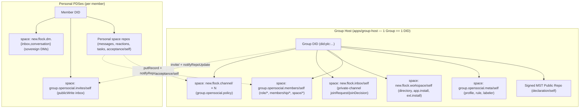
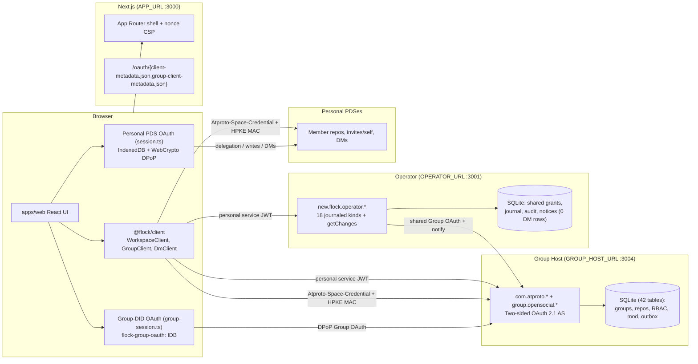

# Developer onboarding

This guide is for engineers who already know **AT Protocol** (DIDs, repos, Lexicon, XRPC, OAuth, PDS) and are onboarding to **ATProto permissioned spaces** (draft [proposal 0016](https://github.com/bluesky-social/proposals)), **`opensocial.group` atmospheric groups** ([`opensocial.group/proposal`](https://tangled.org/opensocial.group/proposal)), and **Flock**.

For deeper module and wire-level references, follow up with [`ARCHITECTURE.md`](../ARCHITECTURE.md), [`CODE-MAP.md`](../CODE-MAP.md), [`docs/protocol/atproto-spaces-pin.md`](protocol/atproto-spaces-pin.md), [`docs/protocol/operator-contract.md`](protocol/operator-contract.md), and [`docs/operations.md`](operations.md).

---

## What you are building

Flock combines a **stateless Next.js browser app** (`apps/web`), a **reference `opensocial.group` Group Host** (`apps/group-host`), and a **shared-session Operator** (`apps/operator`), plus personal PDSes where members hold their own accounts and repos:

- **Groups (`1 Group == 1 DID`):** Every workspace is an `opensocial.group` atmospheric group with its own `did:plc:...` identity hosted on `apps/group-host` (`GROUP_HOST_URL`). Its core governance spaces (`group.opensocial.meta/self` and `group.opensocial.members/self`) and Flock modality spaces (`new.flock.workspace/self`, `new.flock.inbox/self`, `new.flock.channel/<skey>`, `new.flock.app.inbox/<appSkey>`, `new.flock.ext.tasks/<tasksSkey>`) use **`group.opensocial.policy` flat union RBAC** (`role/*` + `membership/*`).
- **Member-owned content:** Messages, reactions, Tasks operations, private-channel join requests, and bilateral `group.opensocial.acceptance/self` records live in **each member's personal PDS repo**; Group Host stores `<groupDid>`-authored governance/directory/label records and tracks authorized space writers (`space_writer`), never copying member message repos.
- **Sovereign Direct Messages (`new.flock.dm.*`):** Hosted strictly on participants' personal PDSes using `com.atproto.memberspace.policy`. Neither Group Host nor Operator ever holds DM scopes or stores DM rows in SQLite.

**Status:** alpha, pinned to `@atproto` Spaces [PR #5187](https://github.com/bluesky-social/atproto/pull/5187) (`6747610566eee1b6d743617bd8eb1136adccb362`, snapshot `0.0.0-spaces-alpha-20261117141222` + `strict-credential-expiry.patch`) and `opensocial.group/proposal` (`8df0cc82eb7708f090aa43522adf1d3ada3ed7e7`).

---

## Classic ATProto vs Spaces vs `opensocial.group`

| Concept | Classic ATProto Repo | Personal-PDS Memberspace (DMs & `invites/self`) | `opensocial.group` Atmospheric Group (Workspaces) |
|---------|----------------------|-------------------------------------------------|---------------------------------------------------|
| Identity | `at://<userDid>/<collection>/<rkey>` | `at://<userDid>/space/<spaceType>/<skey>` | `1 Group == 1 did:plc:...` (`at://<groupDid>/space/<spaceType>/<skey>`) |
| Policy & ACL | Public repo + OAuth `repo:` scopes | `com.atproto.memberspace.policy` + per-space member list | `group.opensocial.policy` (`grants: [{ role, read, write, scopes? }]`) + `role/*` & `membership/*` in `members/self` |
| Scaling across 100 spaces | N/A | Per-space `putMembers` / `removeMembers` | **`O(1)` single `putRecord(membership/<did>)` write** |
| Hosting | Personal PDS | Each participant's personal PDS | Group Host (`#atproto_pds` + `#opensocial_group`), portable across Group Hosts via Standard or Coordinated v1 migration |

---

## Runtime boundaries (four processes, strict isolation)

**Rules of thumb:**

- **Next.js (`apps/web`)** holds **zero secrets, zero databases, and zero member tokens**.
- **Two isolated browser OAuth clients** coexist cleanly: `session.ts` authenticates against the user's personal PDS (`@atproto/oauth-client-browser`), while `group-session.ts` (`GroupBrowserOAuthClient`) uses base `OAuthClient` with per-viewer IndexedDB `flock-group-oauth:${viewerDid}` so Group-DID sessions never overwrite the personal PDS session.
- **Three complementary session modes** drive group operations: (1) personal PDS service-auth/repo calls for ordinary members (`requestJoin`, `leaveGroup`, `createReport`, `acceptance/self`, `invites/self`), (2) per-user Group-DID OAuth (`GroupClient`) for moderation, join-request review, profile/rules, invites, reactivation, step-up deletion, and migration, and (3) Operator's shared Group-DID application session for multi-space modality orchestration and 1-webhook-per-space `notify` fan-in.

---

## Group anatomy & bilateral membership

A group/workspace is anchored at its `groupDid`:
- Core metadata: `at://<groupDid>/space/group.opensocial.meta/self` (`profile/self`, `rule/*`, `labeler/self`)
- Core membership & roles: `at://<groupDid>/space/group.opensocial.members/self` (`role/*`, `membership/<did>`, member-authored `acceptance/self`, host-maintained `space/<tid>` index of unlisted=false modality spaces)
- Flock workspace modality: `at://<groupDid>/space/new.flock.workspace/self` (`directory/*`, `app.install/*`, `ext.install/*`)

**Authorization vs roster display (`WorkspaceSummary`):**
- **Authorization** (`effectiveMemberPermissions`, Group Host RBAC, Operator capability checks) comes **strictly** from `<groupDid>`-authored `membership/<did>`, `role/*`, `group.opensocial.policy`, and `assignable` — never from personal-PDS `acceptance/self` (so `createWorkspace` succeeds before the creator writes `acceptance/self`).
- **Roster display** pairs `<groupDid>`-authored `membership/<did>` (`"new.flock.incarnation"`) with `<did>`-authored `group.opensocial.acceptance/self` (`"new.flock.incarnation"`): matched bilateral pairs appear in `members`, while `membership`-only appears in `pendingMembers`.

---

## Reading spaces: delegation, `authorizeSpaceSync`, and HPKE KEM-MAC

1. The browser requests a short-lived delegation token (`com.atproto.space.getDelegationToken`) from the viewer's personal PDS.
2. It calls `com.atproto.space.authorizeSpaceSync` on the space authority (Group Host for group spaces; participant PDS for DMs or `invites/self`), binding a 10-minute `Atproto-Space-Credential` to a non-extractable WebCrypto P-256 `SpaceKey`.
3. Every read presents RFC 9421 `createSpaceSigHeaders` (`tag="atproto-space-credential"`), and authoritative reads (`getRecord`, `getLatestCommit`, every `listRepoOps` page, and `getRepo` `application/vnd.dasl.star`) verify ephemeral HPKE KEM-MACs (`Accept-Signature`, `info: "atproto-mac"`) against each writer's `#atproto_kem` key (`packages/protocol/src/atproto/space-credential-core.ts`).

---

## Multi-space Operator journal & demoted-actor takeover

Multi-space modality changes (`createWorkspace`, `createChannel`, `transitionChannel`, `archiveChannel`, private-channel `decideJoinRequest`, group-admission `decideGroupJoinRequest`, `installApp`, `updateAppAccess`, `uninstallApp`, `enableExtension`, `disableExtension`, etc.) execute through `new.flock.operator.execute`:

- Before admission, before **every step**, and on crash recovery, Operator re-reads live `members/self` (`role/*`, `membership/*`) and all space `group.opensocial.policy` records to verify `effectiveMemberPermissions` and `assignable`.
- If the submitting admin (`operation.actor`) is demoted or removed before completion (`OPERATION_TAKEOVER_MIGRATION = 4`):
  - `0` completed steps → transitions terminally to `aborted_actor_revoked`.
  - `>= 1` completed steps → another live effective human admin with `assignable` coverage can resume the operation to completion (`taken_over_by = executorActor.did`, audited via `operationAdminTakeover`).

---

## Cross-PDS invitations, notifications, and moderation

- **Invitations (`group.opensocial.invites/self`):** On sign-in/discovery, `WorkspaceClient.ensureInvitesSpace()` idempotently creates `at://<viewerDid>/space/group.opensocial.invites/self` (`com.atproto.memberspace.policy` `{ publicRead: false, publicWrite: true }`, zero members) and registers a stateless 30-min `inv1` push-wake token via `new.flock.operator.getSpaceNotifyTarget`. Inviting groups write `group.opensocial.invite/<tid>` into `<groupDid>`'s repo in that space; invitees redeem via `group.opensocial.requestJoin`.
- **Change feed (`new.flock.operator.getChanges`):** Operator registers 1 stable webhook per group space (`registrations.ts`) and merges group space cursors with `inv1` invite wakes and ephemeral in-memory `dm1` DM wakes (`getDmNotifyTarget`).
- **Moderation (`packages/protocol/src/moderation.ts`):** Members report content/accounts via `group.opensocial.createReport`; moderators triage `listModSubjects` / `getModSubjectHistory` / `resolveModSubject` and write `com.atproto.label.record` (`!takedown`, `!hide`). `!takedown` records remain in the writer's repo so LtHash commit verification stays intact, while `moderation.ts` withholds them identically across `@flock/client`, `@flock/reader`, `apps/web`, `apps/echo-bot`, and `apps/webhooks`.

---

## Lexicons and packages

| Layer | NSID prefix | Count & Role |
|-------|-------------|--------------|
| Flock modality, DM & Operator | `new.flock.*` | **`36` schemas** under `packages/protocol/lexicons/new/flock/` (workspace, channel, inbox, app, tasks, sovereign DMs, operator XRPCs incl. `getSpaceNotifyTarget` & `getDmNotifyTarget`, `permissions/member`) |
| Atmospheric groups | `group.opensocial.*` | **`27` vendored schemas** under `packages/protocol/lexicons/group/opensocial/` (`meta`, `members`, `invites`, `policy`, `declaration`, `profile`, `rule`, `labeler`, `space`, `role`, `membership`, `acceptance`, `invite`, 4 permission sets, 9 join/mod XRPCs) |
| ATProto core & Spaces | `com.atproto.*` | **`72` vendored schemas** under `packages/protocol/lexicons/com/atproto/` (`space`, `memberspace`, `managedspace`, `personalspace`, `identity`, `label`, `repo`, `server`, `sync`) |

All `99` upstream-vendored schemas (`27` `group.opensocial.*` + `72` `com.atproto.*`) are SHA-256-locked in `packages/protocol/src/opensocial-lexicons.test.ts`, and all `63` public `new.flock.*` + `group.opensocial.*` schemas are checked against live DNS TXT + XRPC by `pnpm verify:lexicons`.

---

## Repository map (where to start)

| Path | Purpose |
|------|---------|
| `apps/group-host/` | Reference `opensocial.group` Group Host (`:3004`): `42` SQLite tables, two-sided OAuth 2.1 AS, signed MST public repo, flat RBAC, moderation, Standard & Coordinated v1 host migration |
| `apps/operator/` | Shared-session modality orchestrator (`:3001`), 18 journaled operation kinds, 1-webhook-per-space `notify` renewal, `dm1`/`inv1` wakes, `getChanges` |
| `apps/web/` | Stateless Next.js UI (`:3000`); personal & Group-DID browser OAuth (`apps/web/src/browser/`) |
| `apps/desk/` | Independent **Flock Desk** Astryx/Next.js browser client (`:3005`, `pnpm dev:desk`); talks directly to personal PDSes & Group Hosts via `@flock/shell` + `@flock/reader` with zero `@flock/client` and zero Operator |
| `packages/shell/` | Browser-pure, Operator-free protocol adapter for Flock Desk (`did-resolver`, `session`, `invites`, `lifecycle-store`, `membership`, `channel`, `moderation`) |
| `apps/echo-bot/`, `apps/webhooks/` | First-party non-roster bot apps built strictly on `@flock/client` |
| `packages/protocol/` | `135` Lexicons, keys, runtime `Lexicons` validator, `@atproto/oauth-scopes` `effectiveMemberPermissions`, moderation, HPKE MAC & STAR verification, Tasks `entity-merge` |
| `packages/net/` | `boundedSafeFetch` SSRF-safe DNS-pinned HTTP fetch |
| `packages/deployment/` | Shared `AppConfig` (`APP_URL`, `OPERATOR_URL`, `GROUP_HOST_URL`, `PLC_URL`, `OPERATOR_SERVICE_REF`) & CSP headers |
| `packages/client/` | Isomorphic sync engine, `WorkspaceClient` (3/5/4-phase journals + `ensureInvitesSpace`), `GroupClient`, `TasksClient`, `DmClient` |
| `packages/reader/` | Independent parity readers (`independent.ts`, `independent-dm.ts`, `independent-tasks.ts`) |
| `packages/testing/` | In-memory `FakeNetwork` + `FakeGroupHost`, verified 1-for-1 against `apps/group-host` by `group-host-parity.test.ts` |
| `scripts/` | `verify-pinned-checkout.mjs`, `codegen-lex.mjs`, `backup-db.mjs`, `verify-public-lexicons.mjs`, `playground.ts` |
| `protocol-tests/`, `features/`, `bdd/` | Multi-PDS/multi-Group-Host acceptance, pinned conformance, Playwright specs, sync/perf budgets, and Gherkin BDD |

---

## Local development (short path)

1. Set up the pinned `@atproto` checkout (`../atproto-spaces-r12` @ `6747610566` + `strict-credential-expiry.patch`) per [`docs/protocol/atproto-spaces-pin.md`](protocol/atproto-spaces-pin.md).
2. `corepack pnpm install --frozen-lockfile && corepack pnpm build`
3. `ATPROTO_PINNED_CHECKOUT=../atproto-spaces-r12 corepack pnpm playground`

Playground starts two personal PDSes, an OpenSocial Group Host, a PLC directory, Operator, and Next.js, printing four personal DIDs with password `playground-pass`.

---

## FAQ

### How is a workspace represented in R13?
Every workspace is an **`opensocial.group` atmospheric group** (`1 Group == 1 did:plc:...`) hosted on `apps/group-host`, containing `group.opensocial.meta/self`, `group.opensocial.members/self`, and Flock modality spaces (`new.flock.workspace/self`, `new.flock.inbox/self`, `new.flock.channel/<skey>`, etc.).

### Why was `pnpm reconcile` (`reconcile-workspaces.ts`) deleted in R13?
In R12, adding or removing a member required `O(spaces)` `com.atproto.memberspace` fan-out calls across every channel, which could drift if interrupted. In R13, every group space uses `group.opensocial.policy` referencing roles in `group.opensocial.members/self`, so a single `putRecord` or `deleteRecord` on `membership/<did>` updates access across all 100 channels atomically in `O(1)` writes.

### Why are there two OAuth clients in the browser?
`apps/web/src/browser/session.ts` holds the user's **personal PDS session** (`@atproto/oauth-client-browser`). `apps/web/src/browser/group-session.ts` (`GroupBrowserOAuthClient`) uses base `OAuthClient` with an isolated IndexedDB (`flock-group-oauth:${viewerDid}`) to hold **per-group `<groupDid>` sessions** when acting as a moderator, profile editor, or admin directly against `apps/group-host` without clobbering the personal session.

### Why are there two join-request decision operations on Operator?
`decideJoinRequest` handles **private-channel** access requests stored in `at://<groupDid>/space/new.flock.inbox/self` (granting the `channel-<skey>` role on `membership/<did>` and writing `new.flock.joinDecision`). `decideGroupJoinRequest` handles **group-level** `joinPolicy: "approval"` requests on Group Host (`If-Join-Request-Present: true` atomic `membership/<member>` creation or `group.opensocial.denyJoinRequest`).

### Why does `!takedown` filter records in the sync/projection layer instead of omitting them from `getRepo` on Group Host?
Because member messages live in signed, LtHash-verified writer repos on personal PDSes (and `<groupDid>` space repos are also LtHash-verified by readers), omitting a record on the wire would break cryptographic repo verification. Publishing `com.atproto.label.record` (`val: "!takedown"`) lets every compliant syncer/client (`packages/protocol/src/moderation.ts`) verify the repo integrity first and withhold taken-down content identically.

### Why must `pnpm verify:lexicons` pass before launching against public ATProto PDSes?
On pinned ATProto PDSes, `OAuthProvider.authorize()` calls `lexiconManager.getSpacesFromScope()`, which resolves every non-wildcard `space:<nsid>` token via `_lexicon.<authority>` DNS TXT → XRPC `com.atproto.lexicon.schema`. In local/CI tests, `publishAppLexicons` seeds `TestNetworkNoAppView`'s local `lexiconAuthority`; in production, both `_lexicon.opensocial.group` and `_lexicon.*.flock.new` must be live in public DNS before public PDS users can authorize `memberGrantScopes` or `appGrantScopes`.
