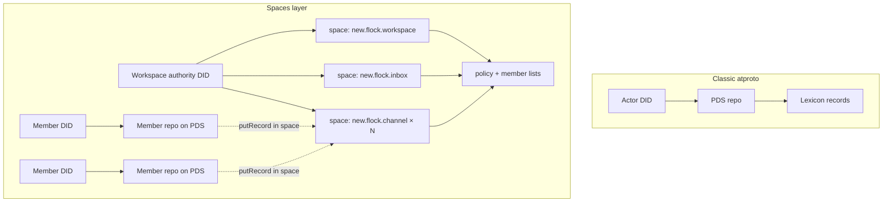
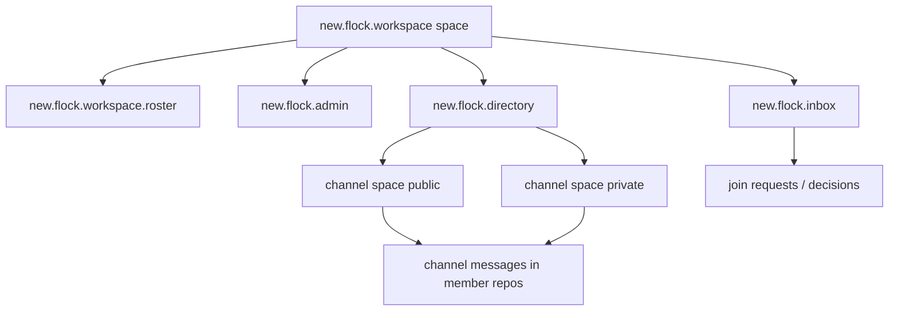
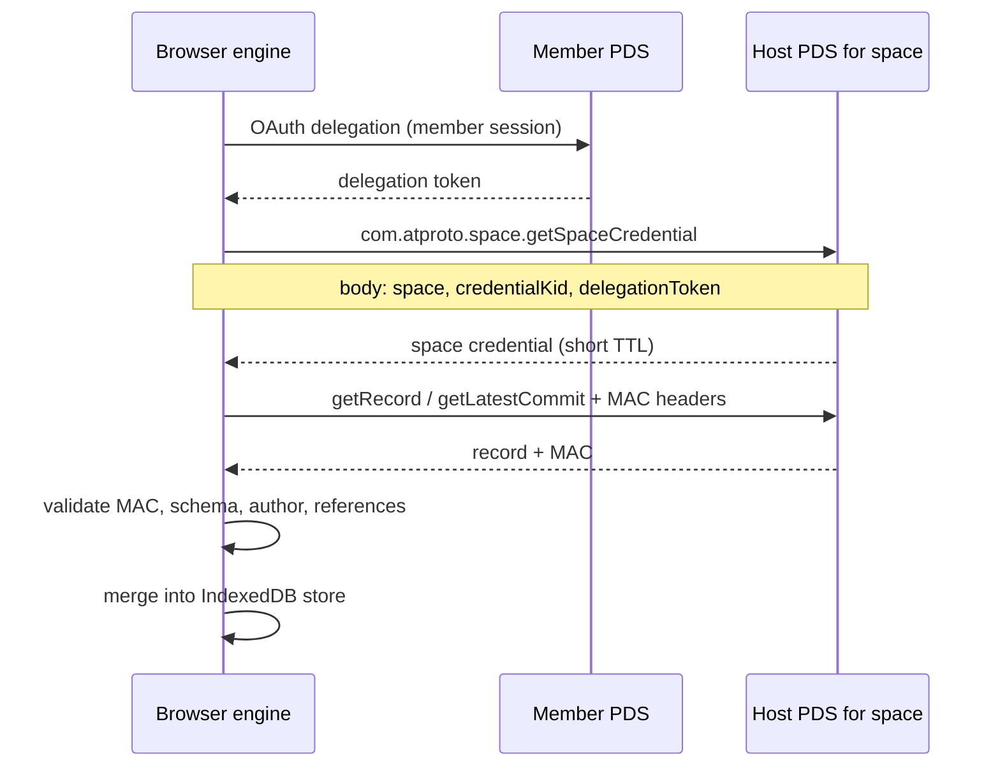
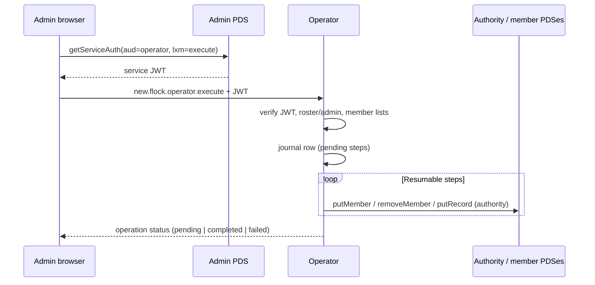
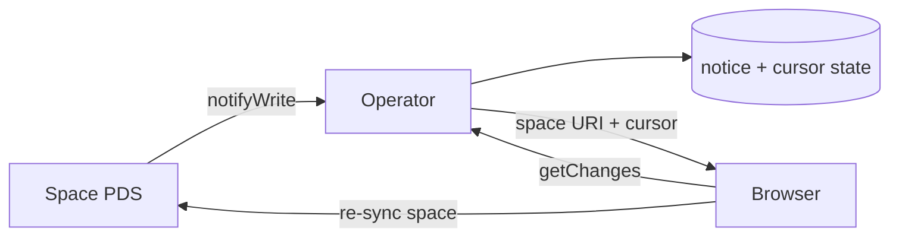
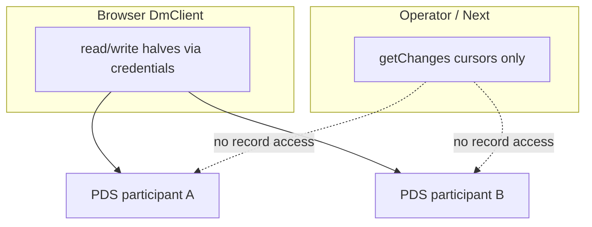

# Developer onboarding

This guide is for engineers who already understand **AT Protocol** (DIDs, repos, Lexicon, XRPC, OAuth, PDS) but are new to **permissioned spaces** (draft [proposal 0016](https://github.com/bluesky-social/proposals)) and to **Flock**, the Slack-style workspace in this repository.

For runtime detail and file-level ownership, follow up with [`ARCHITECTURE.md`](../ARCHITECTURE.md), [`CODE-MAP.md`](../CODE-MAP.md), [`docs/protocol/atproto-spaces-pin.md`](protocol/atproto-spaces-pin.md), and [`docs/protocol/operator-contract.md`](protocol/operator-contract.md).

---

## What you are building

Flock is a **browser client** plus a small **operator service**. There is **no application database of record** for workspace or channel content. Durable state lives in **spaces on members’ PDSes**; **member lists** enforce who can read and write. The operator keeps a **SQLite journal** only for resumable admin mutations, OAuth material for the workspace authority, and **content-free** change notices—not for messages, roles, or membership truth.

**Status:** alpha, pinned to a draft PDS implementation ([PR #5187](https://github.com/bluesky-social/atproto/pull/5187), commit `5d88b414`). Expect breakage when upstream moves.

---

## Classic atproto vs spaces (mental model)

On classic atproto, your **repo on your PDS** is the natural unit: public records, OAuth `repo:` scopes, CAR/export semantics.

**Spaces** add a second layer:

| Concept | Classic repo | Space |
|--------|----------------|-------|
| Identity | `at://did/repo/collection/rkey` | `at://authority-did/space/<collection>/<skey>` |
| Access control | Mostly public vs app passwords / OAuth | **Policy** on the space + **per-member list** on the PDS |
| Reads/writes | Session or app password to your PDS | **Space credential** (short-lived), bound to a client key, often with **MAC** on sensitive XRPC |
| Hosting | One repo per account | Space **records** still live in **participants’ repos**, coordinated by the space host (PDS) |

Flock’s workspace is not “one big shared repo.” It is **one workspace authority DID**, several **space URIs** (workspace, inbox, each channel, extensions), and **many member repos** that hold the actual `new.flock.*` records the sync engine aggregates.



---

## Runtime boundaries (three processes, three trust zones)

```mermaid
flowchart LR
  subgraph browser["Browser"]
    UI[apps/web UI]
    SESS[Member OAuth session\nIndexedDB + DPoP]
    ENG[@flock/client engine\nIndexedDB cache per account]
    UI --> SESS
    UI --> ENG
  end

  subgraph next["Next.js (APP_URL)"]
    PAGES[App shell + static routes]
    META["/oauth/client-metadata.json"]
  end

  subgraph op["Operator (OPERATOR_URL)"]
    XRPC[new.flock.operator.*\ncom.atproto.space.notify*]
    AUTHF[Workspace authority OAuth\n/authority/*]
    DB[(SQLite: journal,\ngrants, notices)]
  end

  subgraph pds["Member PDSes"]
    STAR[com.atproto.space.*\ncom.atproto.memberspace.*]
  end

  ENG -->|space credential| STAR
  ENG -->|getServiceAuth JWT| XRPC
  SESS -->|delegation token| STAR
  op -->|authority session| STAR
  STAR -->|notifyWrite| XRPC
  XRPC --> DB
  browser --> PAGES
```

**Rules of thumb:**

- **Member OAuth** lives only in the **browser**. The Next server does not hold member tokens or serve member XRPC.
- **Workspace authority OAuth** lives only on the **operator**. It performs owner-level membership changes the browser must not hold.
- **Channel/workspace reads** are **client-direct** to each PDS with a space credential; the operator does not proxy record bodies.

---

## Workspace anatomy

A **workspace** is anchored at:

`at://<authority-did>/space/new.flock.workspace/<workspace-skey>`

The authority DID authors **roster**, **admin**, **directory**, and **channel** metadata records. Each **channel** is its own space. The **inbox** space holds join-request traffic. **Apps** and **extensions** (e.g. tasks) get additional spaces and install records.



**Source of truth:**

- **Who can read/write** → PDS `com.atproto.memberspace.*` for each space URI.
- **Product metadata** (names, visibility, admin flags) → authority-authored records, reconciled with member lists on admin actions.
- **Message text** → records in **members’ repos**, validated and merged by `@flock/client` (not stored in operator SQLite).

---

## Reading: delegation, space credential, MAC

You still use the member’s **OAuth access token** to obtain a **delegation token** from their PDS. You exchange that for a **space credential** tied to a **non-extractable browser signing key** (default ~10 minutes, max 1 hour). Requests present `Atproto-Space-Credential` message signatures.

For methods that return authoritative data (`getRecord`, `getLatestCommit` on the pinned API), the client also performs a **KEM/MAC dance** (`Atproto-Space-Want-Mac` / `Atproto-Space-Mac`) so the response is bound to the author’s `#atproto_kem` key.



The sync engine (`packages/client/src`) lists writers via space APIs, follows revisions, and **invalidates cache** when credentials fail with “access lost” or the space is deleted.

---

## Admin mutations: operator + service auth + journal

Members post messages and reactions with normal space writes. **Membership and structure changes** (invite, remove, promote, create channel, join decisions, app installs) go through the **operator** so they can be **journaled, idempotent, and resumable** across PDS steps.



The journal stores **operation identity, request hash, step progress, and errors**—never message bodies, join-request text, or credentials. See [`operator-contract.md`](protocol/operator-contract.md) for every `execute` variant and idempotency rules.

---

## Staying in sync: notices and getChanges

The operator registers as a **notify sink** on spaces it creates. PDS calls `com.atproto.space.notifyWrite` (and `notifySpaceDeleted` when applicable). The browser polls `new.flock.operator.getChanges` with a **service JWT** to learn **which followed spaces moved** (cursors only—no record reads).



Inbox join-request recovery also uses **`listInboxWriters`** (owner-only via authority) plus the admin’s **inbox credential** to read candidate repos—because writer index alone can miss a lost notify.

---

## Direct messages (stricter boundary)

DMs are **person-scoped**, not workspace-owned. **No server component** reads DM record bodies. The same `@flock/client` `DmClient` runs in the browser (and in Node tests); the operator’s `getChanges` may return cursors for DM spaces but **never mints member credentials or reads DM content**.

Each participant owns **their half** of `new.flock.dm.conversation/<key>` on their PDS plus a **self inbox** space. Senders check **`new.flock.dm.declaration`** in the recipient’s **public repo** before requesting (spaces no longer allow probing a foreign inbox via credential exchange).



Details: `.ai/plans/direct-messages.md`, `ARCHITECTURE.md` (“Direct-message runtime boundary”), `packages/reader/src/independent-dm.ts` (parity proof).

---

## Lexicons and protocol packages

| Layer | NSID prefix | Role |
|-------|-------------|------|
| Flock product | `new.flock.*` | Workspace, channel, DM, app, operator methods (41 documents under `packages/protocol/lexicons/new/flock/`) |
| Spaces platform | `com.atproto.space.*` | Space lifecycle, STAR reads, credentials, records (vendored/pinned) |
| Membership | `com.atproto.memberspace.*` | Member lists, policies |
| Service auth | `com.atproto.server.getServiceAuth` | Operator JWTs with `aud` + `lxm` |

Generated types and validators live under `packages/protocol/src/`. **NSIDs are centralized** in `packages/protocol/src/nsids.ts`; do not hard-code new ones elsewhere.

On the pinned PDS, third-party `new.flock.*` schemas are **not** dynamically validated server-side— the app runs `validateSpaceRecord` locally before writes.

---

## Repository map (where to start)

| Path | Purpose |
|------|---------|
| `apps/web/` | Next.js UI; **browser-only** OAuth (`apps/web/src/browser/`) |
| `apps/operator/` | XRPC operator, authority grant flow, SQLite |
| `packages/protocol/` | Lexicons, space adapter, scopes, credential core |
| `packages/client/` | Sync engine, IndexedDB store, `DmClient` |
| `packages/reader/` | Independent readers (proof of interoperability) |
| `features/*.feature` | Executable behavior contract (Gherkin) |
| `protocol-tests/` | Pinned PDS acceptance + app acceptance |

---

## Local development (short path)

1. Pin and build atproto per [`docs/protocol/atproto-spaces-pin.md`](protocol/atproto-spaces-pin.md) (`atproto-spaces-phase3` + `strict-credential-expiry.patch`).
2. `corepack pnpm install --frozen-lockfile && corepack pnpm build`
3. `ATPROTO_PINNED_CHECKOUT=../atproto-spaces-phase3 corepack pnpm playground`

Playground spins up in-memory PDS hosts, PLC, and the app. Use the printed DIDs (not handles) to sign in. For deployment layout, see [`README.md`](../README.md) and [`docs/operations.md`](operations.md).

Tests require the same `ATPROTO_PINNED_CHECKOUT`; see the test table in the README.

---

## Further reading

- [`ARCHITECTURE.md`](../ARCHITECTURE.md) — authoritative data-flow and storage rules
- [`docs/protocol/atproto-spaces-pin.md`](protocol/atproto-spaces-pin.md) — pin, drift table, authority scopes
- [`docs/protocol/operator-contract.md`](protocol/operator-contract.md) — execute variants, auth, idempotency
- [`docs/presentation/r12-atproto-conference-deck.html`](presentation/r12-atproto-conference-deck.html) — narrative deck (GitHub Pages link in README)

---

## FAQ

### What is a “space” in one sentence?

A **named permissioned partition** on a PDS (`at://authority/space/collection/skey`) with a **policy** and **member list**, whose records are stored in **participants’ repos** and read through **space credentials**, not through classic unscoped repo OAuth alone.

### How is that different from making a private Bluesky list or a custom lexicon on my repo?

Your repo is still **yours**. A space adds **cross-repo coordination**: the host enforces **who** may read/write **which collection keys** in that space, and apps exchange **credentials** scoped to that space. Flock never relies on “one shared server database” for channel history.

### Who is the workspace “authority”?

A **dedicated DID** (the operator deployment’s workspace authority) that **owns** workspace/inbox/channel **space definitions** and authors **directory, roster, and admin** records. It is **not** the same as an individual member’s DID, though operators use its OAuth session server-side.

### Where do channel messages actually live?

In **each author’s repo** on their PDS, as `new.flock.channel.message` (and reaction) records **in the channel space**. Readers merge writers by listing repos / following sync rules in `@flock/client`. The operator does **not** store or relay message bodies.

### Why does the operator have SQLite at all?

For **(1)** encrypted workspace-authority OAuth state, **(2)** the **mutation journal** and audit trail, **(3)** notify registrations and **content-free** change cursors. It is explicitly **not** a cache of messages or a membership ACL of record.

### What is the difference between my OAuth token and a space credential?

**OAuth** proves the **member account** and delegates repo/space/scopes. A **space credential** is a **short-lived, space-scoped** token bound to a **client signing key**, minted by the PDS hosting that space, and presented with **HTTP message signatures** (and often MAC on reads).

### What is STAR / `getRepo` and does Flock use it?

STAR is the newer **space-tied repo export** shape on the pinned API. Flock primarily uses **incremental sync** (`listRepos`, per-record reads with MAC) rather than full STAR rebuilds—see the pin doc for the trust tradeoff on `listRecords` vs per-record MAC.

### Why does history use `listRepos` if `removeMember` evicts writers?

Writer eviction is **protocol behavior**: removed members may disappear from a **cold** history rebuild even though old records still exist in their repos. Flock documents this as an accepted product limit; see [`atproto-spaces-pin.md`](protocol/atproto-spaces-pin.md) (“Departed authors’ history”).

### Can the Next.js server or operator read my DMs?

**No record bodies.** DM reads/writes happen only in the **browser** (or test harness) via `DmClient`. The operator may learn **that a DM space had a write** (notify metadata) and expose **cursors**—see `docs/operations.md` for the precise residual signal.

### Why two OAuth flows?

**Members** use **browser public OAuth** (`/oauth/client-metadata.json` on the app origin) with `space:`, `repo:`, and `rpc:` scopes for workspaces and DMs.

**Workspace authority** uses a **confidential client** on the **operator origin** (`/authority/*`) with scopes limited to **space management**—no DM, no member message access.

### How do invites work without space discovery?

Permissioned spaces do not yet offer “list all spaces I’m in.” An admin **adds a DID** via the operator and shares an **invite link**; the link is UX only—the **PDS member list** is the gate. Workspace discovery may use `read_self` on `new.flock.acceptance` / `listSpaces` patterns described in the operator contract.

### What are `notifyWrite` and `getChanges` for?

**notifyWrite** lets the PDS push **write hints** to registered sinks (the operator). **`getChanges`** lets the browser ask “which spaces I follow have new cursors?” without the operator reading records.

### What breaks when we drift the atproto pin?

Everything touching **credentials, MAC, policy shape, or error codes**. Treat pin drift as a **release blocker** until `protocol-tests/atproto` and app acceptance pass again. The drift table in [`atproto-spaces-pin.md`](protocol/atproto-spaces-pin.md) is the checklist.

### Should I pass `validate: true` to PDS writes for `new.flock.*`?

**Not on the current pin.** Validate locally with `validateSpaceRecord` before `putRecord` / `applyWrites`. The PDS built-in schema map does not include third-party Flock lexicons.

### What is `@flock/reader` for?

A **deliberately separate** package that reconstructs workspaces, DMs, or tasks using **only** published lexicons + PDS—no imports from `@flock/client` or operator code. If the reader works, the data model is not locked inside this app.

### Where do operator RPC scopes come from?

`packages/protocol/src/scopes.ts` (`memberGrantScopes`, admin `rpc:` scopes per method). Tests in `scopes.test.ts` guard separation between member and authority grants.

### How do I debug a stuck admin operation?

Check `new.flock.operator.getOperation` and journal semantics in [`operator-contract.md`](protocol/operator-contract.md). Operations can stay `pending` under lock/time limits and are **safe to retry** with the same `operationId` and request hash; conflicting hashes return **409**.

### Is there another HTTP surface besides operator XRPC?

The **web app** only adds **member OAuth metadata**. Optional **`apps/webhooks`** is a separate inbound integration (not on the hot path for the main UI). Member **data plane** traffic goes **browser → PDS**; **control plane** admin traffic goes **browser → operator** with **service auth**.